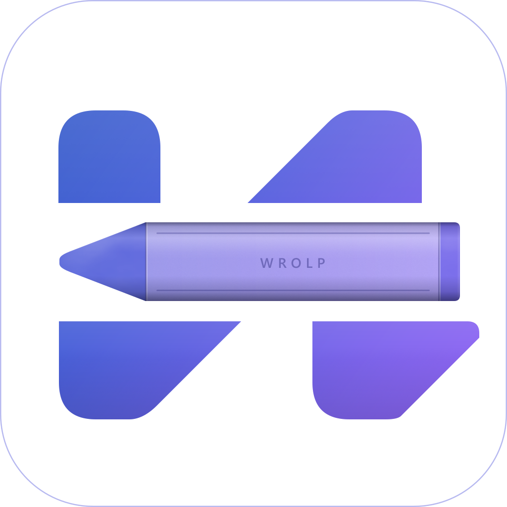
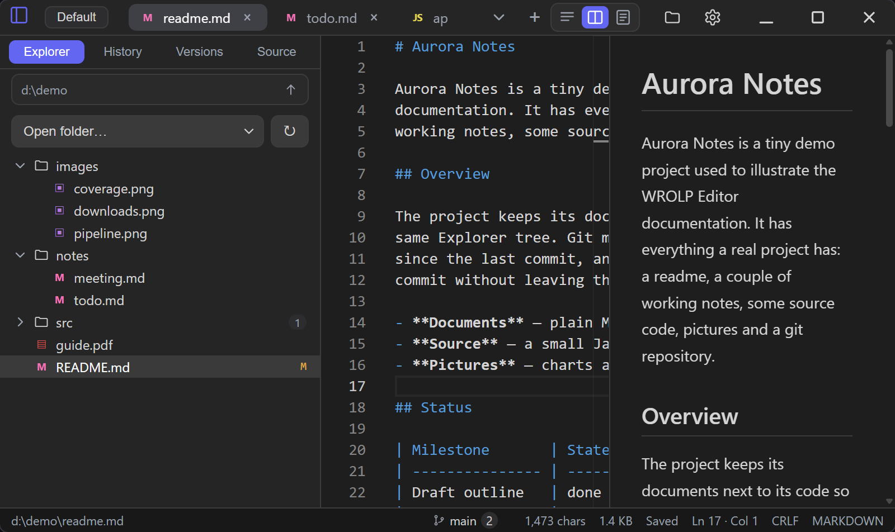

<p align="center">
  
</p>

# WROLP Editor

English | [简体中文](README.zh.md)

A small local text editor for Windows: tabs, Markdown preview, PDF and Office documents, picture galleries, archives, version history, built-in Git and AES-256-GCM encryption.

**[Documentation](https://wrolp.github.io/wrolp-editor-docs)** · [Release notes](RELEASE_NOTES.md) · [Download](https://github.com/wrolp/wrolp-editor/releases/latest) · [Issues](https://github.com/wrolp/wrolp-editor/issues)



## What it does

| Area | What you get |
| --- | --- |
| Tabs | One window, many files. Dirty markers, an open-files list, per-tab settings, tab groups that bring back their own tree, and cursor positions restored per file |
| Editing | Monaco: highlighting by extension, minimap, one model per file. `Ctrl+S` writes the file; drafts are kept about 500 ms after you stop typing and offered back on the next open |
| Markdown | Rendered beside the source, with an outline, Monaco-coloured code blocks and `mermaid` / `plantuml` / `graphviz` drawn as SVG. A document's own HTML passes a whitelist — no scripts, no event handlers |
| PDF | A reader of its own: one continuous column, 25–400 %, white / warm / green / night paper, bookmarks, automatic scroll, and the page you left remembered per file |
| Office | Word, spreadsheet and slide files open in the app. The Word preview pages the document, zooms, fits the width, hides page gaps, tints the paper and shows the page you are on |
| Pictures | A whole folder in a gallery tab: stacked, one by one, slideshow or grid. Inside an archive, pictures open in the gallery without unpacking anything first. A screenshot pasted into a Markdown file is saved beside it and linked; pasted into the Explorer, it becomes a PNG. Windows' own OCR makes the text on a picture selectable and copyable, with no download |
| Archives | zip, tar, tar.gz and 7z are browsed in the Explorer, unpacked into a read-only cache that every viewer can use. Encrypted archives take a password from the session, a rule on the name, the default password, or a prompt |
| Files | Batch rename by pattern or regular expression, side-by-side comparison of any two contents, and configuration backup snapshots |
| Notes | A sidebar view over ordinary markdown files in one folder: pin, tags and a due date in a small front-matter header drive the order and the colour, and a note opens as a normal tab. Scratch tabs can be saved as notes, and the folder may live on a sync drive |
| Version history | Off by default. Once on, every save by hand records the file, and any two versions — or a version and what is open — can be compared or brought back |
| Source control | A real Git view: staged and unstaged changes, diffs, commits and history, branches, a three-way merge editor, and fetch / pull / push over HTTPS or SSH |
| Encryption | A self-describing AES-256-GCM container keyed from a password, with an idle lock; drafts are sealed with the same key |
| Window | Size, position, maximised state and the interface language (中文 or English) come back the way they were left |

## Install

Take the latest NSIS installer from [Releases](https://github.com/wrolp/wrolp-editor/releases/latest). It needs Windows 10/11 x64 and the WebView2 runtime, which current Windows already has. The context-menu entry is a setting, and starting the app again hands its paths to the window that is already open.

## Development

Requirements:

- Windows 10/11 with the WebView2 runtime
- Rust with the MSVC toolchain (`x86_64-pc-windows-msvc`) and the Visual Studio C++ Build Tools workload
- Node.js `^20.19` or `>=22.12` (required by Vite 8), with npm

```bash
npm install
npm run tauri dev     # Vite on localhost:1520

npm run tauri build   # -> src-tauri/target/release/bundle/nsis/WROLP Editor_<version>_x64-setup.exe
npm run release       # signed build, then latest.json
npm run upload        # publish the release at that commit
```

`release` and `upload` refuse unless the three version fields agree, the tree is clean and `v<version>` is a local tag on HEAD. The build is signed with `.tauri/priv.key`, which is untracked and must be backed up.

## Where data lives

Everything sits under `%APPDATA%\com.wrolp.editor`: `settings.json`, `state/`, `drafts/`, `kept/`, `shadow/` (version history), `backups/` and `archive-cache/`. Settings → About lists the full paths and opens any of them in Explorer.

## Documentation

Guides for every feature, the data files, the build and the release process are at **https://wrolp.github.io/wrolp-editor-docs**. Per-release changes are in [RELEASE_NOTES.md](RELEASE_NOTES.md).

## License

MIT — see [LICENSE](LICENSE).
