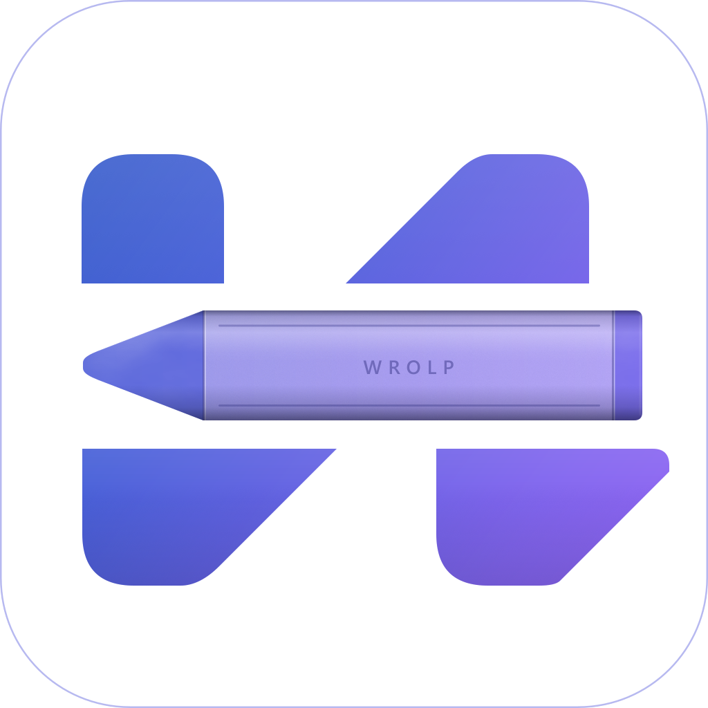
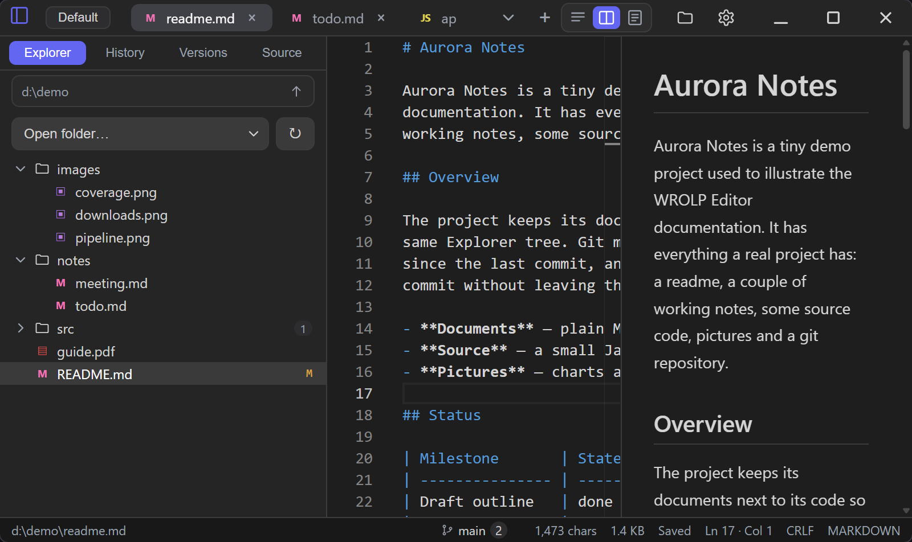

<p align="center">
  
</p>

# WROLP Editor

[English](README.md) | 简体中文

一款 Windows 本地文本编辑器：多标签、Markdown 预览、PDF 与 Office 文档、图片画廊、压缩包浏览、版本记录、内置 Git 与 AES-256-GCM 加密。

**[文档](https://wrolp.github.io/wrolp-editor-docs)** · [发行说明](RELEASE_NOTES.zh.md) · [下载](https://github.com/wrolp/wrolp-editor/releases/latest) · [问题反馈](https://github.com/wrolp/wrolp-editor/issues)



## 能做什么

| 模块 | 行为 |
| --- | --- |
| 多标签 | 一个窗口打开多个文件：脏标记、已打开文件列表、单文件设置、切换分组时连同目录树一起回到原样、按文件还原光标位置 |
| 编辑 | Monaco：按扩展名高亮、minimap、每个文件独立 model。`Ctrl+S` 写回文件；停止输入约 500 ms 后落盘草稿，下次打开时提供恢复 |
| Markdown | 源码右侧渲染，带目录、Monaco 上色的代码块，`mermaid` / `plantuml` / `graphviz` 画成 SVG。文档自带的 HTML 经白名单清洗——不放行脚本与事件处理器 |
| PDF | 自己的阅读器：连续滚动、25–400 %、白纸/米黄/护眼绿/夜间、书签、自动滚动，并按文件记住上次读到哪一页 |
| Office | Word、表格与幻灯片在应用内打开。Word 预览可分页、缩放、适应宽度、隐藏页间空白、改纸张颜色，并显示当前页号 |
| 图片 | 整个目录在画廊标签里浏览：堆叠、一张张、轮播或网格。压缩包里的图片无需先解压即可进画廊。截图粘贴进 Markdown 会存到文档旁并插入链接；粘贴进资源管理器则保存为 PNG |
| 压缩包 | zip、tar、tar.gz 与 7z 在资源管理器里直接浏览，安全展开到只读缓存，现有查看器全部可用。加密包按「会话 → 名称规则 → 默认口令 → 询问」取口令 |
| 文件 | 按规则或正则批量重命名、任意两份内容并排对比、配置备份快照 |
| 版本记录 | 默认关闭。打开后每次手动保存都记下文件当时的内容，任意两版——或某版与当前编辑区——可对比或取回 |
| 源码管理 | 真实的 Git 面板：暂存与未暂存改动、diff、提交与历史、分支、三栏合并编辑器，以及 HTTPS / SSH 上的 fetch、pull、push |
| 加密 | 自描述的 AES-256-GCM 容器，口令派生密钥，空闲自动锁定；草稿用同一把钥匙加密 |
| 窗口 | 大小、位置、最大化状态与界面语言（中文 / English）按上次的样子还原 |

## 安装

从 [Releases](https://github.com/wrolp/wrolp-editor/releases/latest) 取最新的 NSIS 安装包。需要 Windows 10/11 x64 与 WebView2 运行时（近年的 Windows 已内置）。右键菜单集成是设置项；再次启动会把路径交给已打开的窗口。

## 开发

环境要求：

- Windows 10/11，带 WebView2 运行时
- Rust 的 MSVC 工具链（`x86_64-pc-windows-msvc`）与 Visual Studio C++ 生成工具
- Node.js `^20.19` 或 `>=22.12`（Vite 8 的要求），以及 npm

```bash
npm install
npm run tauri dev     # Vite 在 localhost:1520

npm run tauri build   # -> src-tauri/target/release/bundle/nsis/WROLP Editor_<version>_x64-setup.exe
npm run release       # 签名构建，随后写 latest.json
npm run upload        # 把该提交对应的版本发布出去
```

`release` 与 `upload` 会在三处版本号不一致、工作区不干净或 `v<version>` 不是 HEAD 上的本地标签时停下。构建用 `.tauri/priv.key` 签名，该文件不入库，需要自行备份。

## 数据位置

全部位于 `%APPDATA%\com.wrolp.editor`：`settings.json`、`state/`、`drafts/`、`kept/`、`shadow/`（版本记录）、`backups/` 与 `archive-cache/`。设置 → 关于 会列出完整路径，并能直接在资源管理器里打开。

## 文档

每个功能的行为、数据文件、构建与发布流程都写在 **<https://wrolp.github.io/wrolp-editor-docs>**。逐版本的变更见 [RELEASE_NOTES.zh.md](RELEASE_NOTES.zh.md)。

## 许可证

MIT —— 见 [LICENSE](LICENSE)。
