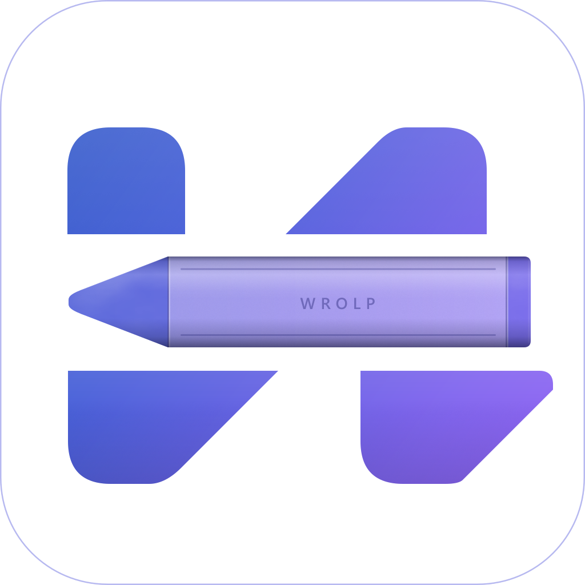

<p align="center">
  
</p>

# WROLP Editor

[English](README.md) | 简体中文

一款 Windows 本地文本编辑器。

技术栈：Tauri v2 + React + TypeScript，编辑区用 Monaco Editor。

## 功能一览

| 模块 | 行为 |
| --- | --- |
| 多标签 | 单窗口多文件；标签脏标记、已打开文件下拉列表、标签右键菜单 |
| 编辑 | Monaco：按扩展名高亮、minimap、每个文件独立 model、切回标签还原光标 |
| 保存 | `Ctrl+S` 写回文件并清除该草稿；未落盘过的 `Untitled-N` 走另存为。另有两项默认关闭的整理：去除行尾空格、补上缺失的行末换行——都先写回缓冲区，所以屏幕上看到的就是写进文件的字节 |
| 未保存的修改 | 与磁盘上那份不一致的行会被染色：新增的行偏绿，改掉了原有文字的行偏黄，保存后标记消失。比对在 `src/lib/dirtyDiff.ts`：工作台自带这套，独立版 Monaco 没有 |
| 换行符 | 读到什么就按什么写回。想强制某个文件用 LF 或 CRLF，去那个标签的「文件设置」；本来没有换行符的文档（新建文件最常见）用设置 → 常规 里选的。状态栏显示的就是保存会写入的换行符。不单独提供 CR：Monaco 的模型只会用 LF 或 CRLF 拼接行 |
| 草稿 | 编辑后约 500ms 防抖落盘；切标签、关标签、窗口失焦时立即冲刷 |
| 自动保存 | 默认关闭。打开后，**当前**磁盘上已存在、又有未保存改动的文件，在连续 N 秒没有再被编辑时静默写回；你再打字，这个文件的倒计时会重来，所以保存落在一次停顿之后而不是句子中间。没在看的标签既不会起新的倒计时，也不会作废正在跑的，它未保存的文本由草稿兜着。未命名标签、锁定的文件、图片，以及磁盘检查正在询问的文件都不动。它的写入默认不记版本，要在「设置 → 版本」里另外打开 |
| 恢复 | 打开文件时把磁盘内容与草稿比对，不一致就直接把草稿装回去，标签保持未保存状态；设置里可以改成每个文件弹「恢复草稿 / 丢弃」询问 |
| 侧边栏 | 资源管理器目录树（子目录懒加载 + 刷新按钮，文件夹在前、名字按自然序，`2.txt` 在 `10.txt` 前）、最近打开的历史列表，以及版本视图。拖动分隔条可调宽（180–640 px，双击复位），宽度会持久化。树的文字大小可在设置里调，11–20 px |
| 图片浏览 | 整个目录在一个标签里按自然序查看（`IMG_2` 排在 `IMG_10` 前）：上下排列、一张张、轮播、整页网格。子文件夹默认不含，打开后最多走四层；单次列表最多 2000 张并明确提示。图片走 asset 协议显示，不受编辑器文本大小上限约束。HEIC 与 TIFF 会被列出，并标明本渲染器画不出来 |
| 批量重命名 | 多选若干行，或整个目录一次改完；用一条规则（`{name}`、`{ext}`、`{n}`）或正则加替换，逐行预览；可按名称、扩展名、修改时间或手动排序，`{n}` 按这个顺序编号。详见[批量重命名](#批量重命名) |
| 版本记录 | 默认关闭。打开后每次手动保存都记下文件当时的内容；任意两条可以并排比对（版本与版本、或任一版本与当前编辑区），可以只看变更，也可以取回编辑器。单个文件可在标签右键菜单里排除或强制纳入，详见[版本记录](#版本记录) |
| 单实例 | 再次启动时把路径交给已运行的窗口，新增标签并聚焦 |
| 设置 | 右键菜单开关、编辑器字号、minimap、界面语言；即时生效并持久化。右键菜单页还会显示当前注册表实际启动的命令，指向别的构建或当前是 debug 构建时给出警告 |
| 语言 | 默认英文，可在设置里下拉切换成中文。所有文案（含 Rust 侧返回的报错）都走同一张 key 表 |
| 版本更新 | 设置 → 关于 可按需检查 GitHub 上的最新版本，下载后交给 passive 安装器并自动重启；不在后台自动检查 |
| 标签分组 | 一个分组就是**一组有名字的标签，外加资源管理器停着的目录**。标题栏上的小牌在同一窗口里切换分组，标签、光标位置和目录树一起换 |
| 移动 / 复制标签 | 标签右键菜单可把标签归到另一个分组。改的是「哪个分组列着它」，磁盘上的文件不动 |
| 配置备份 | 分组、设置、最近文件与文件夹历史的时间戳快照，应用打开和关闭时自动更新，也可手动；超过保留数会删旧的，设置 → 备份 里可任选一份恢复。不含草稿与版本历史 |
| 文件对比 | 两个内容只读并排 diff，任一侧可以是磁盘文件或未保存的 buffer（含未命名标签）；同一个文件的未保存版本有专用入口，重跑同一次比对即刷新快照 |
| 加密文件 | 口令派生密钥、AES-256-GCM 的自描述容器；加密另存为、新建加密文件、改口令、移除加密；空闲自动锁定；可选记住口令到 Windows 凭据管理器；草稿同钥加密 |
| 窗口 | 大小、位置、是否最大化都在下次启动时还原。上次所在的显示器不在了，窗口会被拉回还在用的屏幕上，并说明原因 |

## 快捷键

| 按键 | 作用 |
| --- | --- |
| `Ctrl+S` | 保存（未命名标签走另存为） |
| `Ctrl+O` | 打开文件（可多选） |
| `Ctrl+N` | 新建未命名标签 |
| `Ctrl+W` | 关闭当前标签（其草稿保留） |
| `Ctrl+B` | 切换侧边栏 |

在标签条上滚动滚轮可横向滚动。

## 图片浏览

在资源管理器里右键文件夹（或目录树下方的空白处），选「浏览图片」。目录会在自己的标签里打开，四种方式看的是同一条自然序列表：

- **上下排列**（默认）：一张接一张排开，宽度不超过原图、不放大，上方显示序号、文件名、尺寸与大小。
- **一张张**：单张大图，带缩放、适应窗口、100%，下方是同一目录的胶片条。
- **轮播**：同一个画面按间隔自动前进。鼠标停在画面上会暂停，窗口失焦也会停；间隔与是否循环在设置里，也可从画廊工具条直接改。
- **整页网格**：方形缩略图，可选大、小两档。点任意一张就按该位置进入「一张张」。

普通标签里打开的图片，工具条上有「浏览所在文件夹」，会打开该目录并停在当前这张。画廊只读本地目录——不接图床、不上传、不生成直链。

只有视口附近的图片会挂载，离开两屏的 `` 会从 DOM 移除，让 Chromium 释放已解码的位图；上下排列会用已量到的高度占位，滚回来不会跳位。上下排列里 ↑/↓ 滚动列表、←/→ 换图；「一张张」与轮播里 ←/→ 换图。`Home`/`End` 跳首末，`Space` 播放/暂停轮播（在上下排列里翻一屏），`Esc` 回到「一张张」。资源管理器里改名、删除或粘贴后，开着的画廊会重新取列表。`gallery://` 标签不会写进分组存档，重启只恢复文件标签。

## 批量重命名

在资源管理器里一次改很多个名字：`Ctrl+点击` 选中多行（`Shift+点击` 选连续一段），再点行菜单里的「批量重命名 N 项…」。整个文件夹不必先选中——文件夹自己的菜单、以及文件菜单里（作用于它所在的文件夹）都有「批量重命名此文件夹…」，资源管理器当前目录则在空白处的菜单里。

所有名字都先算好、检查过才动磁盘，被拒绝时文件夹保持原样。对话框一边输入一边列出每行的新名字，与同批另一行撞名的会标出来。

两种规则：

- **规则** —— 把名字拆成 token：`{name}` 是原名（不含扩展名），`{ext}` 是扩展名（含点），`{n}` 是序号。`{name}{ext}` 什么都不改；`photo-{n}{ext}` 给整个目录编号；`{name}-backup{ext}` 给每个名字加后缀。序号从「起始序号」开始，按「补零位数」补零，得到 `01`、`02`… 而不是 `1`、`2`…。
- **正则** —— 对完整文件名（含扩展名）匹配，再替换。`$1` 引用分组，勾上「忽略大小写」等价于加 `i`，没有匹配到的行保持原名。替换串里同样可以用 `{name}`、`{ext}`、`{n}`，所以分组和序号能一起用：`^(.+)\.jpe?g$` → `photo-{n}-$1.jpg`。

序号按**列表里的行**计数，不按匹配到的行：正则模式下没匹配上的行也占一个号，这样只改一部分文件时编号不会乱跳。

应用之前可以先排序——原顺序、名称（数字按数值比较，`photo-9` 在 `photo-10` 前）、扩展名、修改时间、手动——并在升序、降序之间切换。拖动整行，或用悬停时出现的箭头微调顺序，`{n}` 跟着屏幕上的顺序走，可以一直调到编号读起来正确为止。与批外已有条目撞名的，后端会拒绝并提示，而不是覆盖；一个文件夹和它里面的条目不能在同一批里一起改。

改名后，正在显示该文件的标签会保留文本、光标和未保存的编辑。该文档的撤销栈会从头开始，因为 Monaco 没有把缓冲区换到另一个路径的接口。预览里太长而被截断的名字，鼠标悬停会显示完整名称。

## 开始使用

### 环境要求

- Windows 10/11，带 WebView2 运行时（近年的 Windows 已内置）
- Rust 的 MSVC 工具链（`x86_64-pc-windows-msvc`）+ Visual Studio 的 C++ 生成工具工作负载
- Node.js `^20.19` 或 `>=22.12`（Vite 8 的要求）与 npm

### 开发

```bash
npm install
npm run tauri dev
```

debug 构建加载的是 Vite 在 `localhost:1520` 提供的页面。若右键菜单那条注册表指向 `target/debug/wrolp-editor.exe`，只有在 dev server 运行时右键才能打开文件，否则窗口会显示「拒绝连接」页面。日常使用请把菜单指向安装版（设置页会显示当前注册的实际命令）。

### 打安装包

```bash
npm run tauri build
# -> src-tauri/target/release/bundle/nsis/WROLP Editor_<version>_x64-setup.exe
```

只配置了 NSIS 目标（`bundle.targets: ["nsis"]`）。

### 发布

```bash
npm run release   # 打安装包；三个版本号不一致时直接退出
npm run upload    # 创建/补传 GitHub release v<version>，上传 setup.exe
# 或：npm run publish
```

`upload` 需要 `gh` CLI，并用对仓库有写权限的账号登录；仓库地址取自 `git remote get-url origin`（可用 `--repo owner/name` 覆盖），还接受 `--tag`、`--notes`、`--draft`、`--pre` 和 `--dry-run`。

构建用 `.tauri/priv.key` 签名（该文件不入库；用 `npx tauri signer generate -w .tauri/priv.key` 生成并务必备份——丢了它，已安装的版本就无法再接受更新）。`release` 会在安装包旁写出 `latest.json`，`upload` 把两者一起上传；应用从 `https://github.com/wrolp/wrolp-editor/releases/latest/download/latest.json` 读取。构建前先把三个版本号一起改好。

发布说明按语言分成两份手写文件，放在仓库根目录：`RELEASE_NOTES.md`（English）和 `RELEASE_NOTES.zh.md`（简体中文）。`release` 写 `latest.json` 的 `notes`、`upload` 写 GitHub release 的正文时，会先读这两份、英文在上中文在下合并成一段；某个版本只想补一句时，用 `--notes "..."` 临时覆盖。

### 脚本

| 脚本 | 用途 |
| --- | --- |
| `npm run dev` | 在 1520 端口起 Vite dev server（供 `tauri dev` 使用） |
| `npm run build` | 先做类型检查，再产出 `dist/` 生产包 |
| `npm run tauri` | Tauri CLI 透传（`dev`、`build`、`icon` 等） |
| `npm run release` | 校验版本号，签名构建并写出 `latest.json` |
| `npm run upload` | 把安装包与 `latest.json` 上传到 GitHub release |
| `npm run publish` | 依次执行 `release` 与 `upload` |

## 数据存放位置

全部在应用配置目录下 —— Windows 上是 `%APPDATA%\com.wrolp.editor`；设置 → 关于 会列出这些目录的完整路径，并能直接在资源管理器里打开；备份目录在「设置 → 备份」里同样可以打开：

```
wrolp/
├── backups/wrolp-backup-<时间>-<类型>.json   设置、分组、最近文件与文件夹历史
├── drafts/<文件名>-<sha256>.draft  每个文件一份草稿，用所属文件的名字命名
├── kept/<原名>               被删文件的救援副本（明文，见「加密文件」）
├── shadow/<文件名>-<sha256>.git/   每个被跟踪文件一份版本记录，开启版本后才会出现
└── state/
    ├── history.json          最近打开，新的在前，最多 50 条
    ├── settings.json         fontSize、minimap、sidebarVisible、sidebarView、sidebarWidth、sidebarFont、
    │                         language、restoreSession、draftRestore、lineEnding、
    │                         trimTrailingWhitespace、insertFinalNewline、autoSave、autoSaveInterval、
    │                         versioningEnabled、versioningShowLimit、versioningMaxFileSize、autoSaveVersions、
    │                         askNoteOnSave、backupDir、backupRetain、
    │                         encryptIdleMinutes
    ├── file-settings.json    每文件覆盖：编码、换行符、视图设置、版本记录
    ├── groups.json           标签分组：名字、标签、光标位置与资源管理器的目录
    └── window.json           x、y、width、height（物理像素）与是否最大化
```

`<sha256>` 是**规范化**路径的哈希：绝对路径、去掉 `\\?\` 前缀、分隔符统一、Windows 下再转小写。草稿是按它而不是按前面那段可读的 `<文件名>` 对应的——两个不同目录里的 `notes.md` 不会共用一份草稿。文件名写进名字只是因为一目录纯哈希等于一目录无名文件；旧名 `<sha256>.draft` 的草稿会在首次读到时就地改名，清除时两个名字一起清。草稿内容形如：

```json
{
  "path": "d:\\notes\\a.txt",
  "content": "unsaved text",
  "cursor": 12,
  "updatedAt": "2026-10-04T01:13:36Z"
}
```

`cursor` 存的是 Monaco 的 model 偏移量，所以恢复时光标会落回原处。加密文件的草稿不是这个形状，而是用同一把
文件密钥密封过的信封（见「加密文件」）。记住的口令**不在这里**：它们在 Windows 凭据管理器里。

### Tauri 命令

白名单就是 `src-tauri/src/lib.rs` 里 `invoke_handler` 那一份，前端只能调它列出来的命令。按用途大致是：
打开/保存/草稿（`open_file`、`save_file`、`stat_file`、`get_draft`、`save_draft`、`clear_draft`），
目录树与文件操作（`list_dir`、`create_file`、`create_dir`、`rename_path`、`copy_entry`、`remove_entry`、
`keep_file`），分组与会话（`get_groups`、`save_groups`、`transfer_tabs`、`get_window_state`、
`save_window_state`、`plan_window_placement`），设置、备份与右键菜单（`get_settings`、`save_settings`、
`get_store_dirs`、`create_config_backup`、`list_config_backups`、`restore_config_backup`、
`maybe_auto_backup`、`context_menu_target`、`install_context_menu`、`uninstall_context_menu`），版本记录
（`versioning_state`、`set_version_override`、`add_version`、`get_versions`、`get_version_content`、
`list_versions`、`clear_versions`），以及加密（`unlock_file`、
`lock_file`、`lock_all`、`save_file_as_encrypted`、`create_encrypted`、`change_password`、
`remove_encryption`、`remember_password`、`forget_password`、`recall_password`、
`remembered_password_count`、`clear_remembered_passwords`）。

文件读写**故意不用** `fs` 插件：WebView 只能调用上面这些固定命令，不把大范围磁盘 scope 暴露给前端。
口令同理**从不跨 IPC 回到前端**：`recall_password` 只回答「这个路径记没记住口令」这一个布尔值，
口令本身留在 Rust 侧，因为进了 JavaScript 堆的值就等于进了 devtools 控制台。

## 标签分组

一个分组就是**一组有名字的标签**，外加它在前台时**资源管理器显示的那个目录**。标题栏上的小牌显示当前名字，
切换就在那一窗口内把标签和目录树一起换掉。一个分组仍可以装着来自好几个目录的文件——那个目录是「下一次从哪儿挑文件」，
不是「开着的文件来自哪儿」。

- **总有一个分组在用。** 没有任何分组时，窗口会带出一个名为「默认分组」的组，所以标签从第一个开始就被记下来，
  不需要用户先手动新建。「新建分组…」要求输入名字，空名字和重名都被拦下——列表里两行读起来一样就没法区分。
  默认分组同样可以改名；把所有分组都移除后，下次启动会再给一个默认分组。
- **文件并进当前那个。** 从资源管理器右键打开的文件加进眼前的分组；右键不会在你脚下换掉整个上下文。
  「打开文件夹…」和标签右键的「在侧边栏显示所在目录」只动资源管理器，并把目录记在当前分组里，**不建组也不切组**。
  新建的分组从窗口当前所在的目录开始，之后再各走各的。
- **记下来的东西：** 标签顺序、当前选中的标签、每个标签的光标位置（设置里「启动时重新打开上次的标签」可关）、
  资源管理器停在的目录，以及未命名标签的正文——它没有草稿文件，分组是唯一副本。上限 32 个分组、每个 200 个标签、每个未命名
  标签 64 KB。
- **内容绝不存两份。** 有文件的标签只存路径与光标，未保存正文归草稿文件管，key 由路径决定。所以标签能直接
  挪到别的分组而不用搬草稿，草稿也会跟着文件走。
- **移动 / 复制标签**（标签右键菜单）只改标签挂在哪个分组下，**不碰磁盘上的文件**：真挪文件会让按路径哈希的
  草稿 key 变成孤儿。
- **文件被删了**：恢复时跳过，汇总成一条提示，并从该分组记录里去掉。「从列表移除」也只删记录，文件与草稿都不动。

`groups.json` 整存整取（应用单实例，只有一个写入方），落盘走临时文件 + rename。标签路径用的就是草稿哈希前的
同一套规范化形式，所以同一个文件在一个分组里不会出现两条。只有旧名 `workspaces.json` 而没有 `groups.json` 时，
迁移发生在**读取时**：解析旧文件、按新名写出、然后才删掉旧的——所以旧文件损坏时不会被后续保存顺手清掉。旧记录里
多带的 `root` / `autoName` / `sidebarView` 字段会被忽略、缺的字段取默认值，因此不需要额外迁移步骤。

## 配置备份

设置 → 备份 会保存配置的时间戳副本——分组记录丢了就等于标签会话丢了，而这件事没有撤销。默认目录是
`%APPDATA%\com.wrolp.editor\wrolp\backups`；「更改…」可选别的目录，「改用默认目录」回到默认。目录与
保留数量都存在 `settings.json`（`backupDir`、`backupRetain`）。

- **一份快照一个文件。** 文件名是 `wrolp-backup-<YYYYMMDD-HHMMSS-mmm>-<类型>.json`，类型为 `auto`、
  `manual` 或 `pre-restore`。把几个文件打进一条记录而不是逐个复制，是因为分组和它的文件夹菜单由
  分组 id 绑在一起：只恢复其中一个，就可能让菜单指向一个已经不存在的分组。
- **里面有什么：** `settings.json`、`groups.json`、`file-settings.json`、`history.json` 和
  `folder-history.json`，每个都按它当时的原始文本保存。**不含草稿和版本历史**——那些是用户数据而不是
  配置，复制它们会让快照涨到它所保护的工作那么大。快照本身和它复制的文件一样，是明文 JSON。
- **自动与手动。** 当天的自动快照在应用打开和关闭时各刷新一次，所以它总停在那次切换时的配置。每次刷新
  会替换当天更早的自动快照，手动快照不受影响；窗口跨夜一直开着时，由每小时的检查补上。「立即备份」随时
  可以另存一份手动快照。「保留快照数」（1–100，默认 20）在写下一份快照时执行，所以调低数字不会立刻
  删除旧文件。
- **恢复。** 列表按新的在前，显示时间、类型、所含分组/标签数量和大小。选中一份会再确认一次，然后先
  冲刷草稿与分组、为当前状态做一份 `pre-restore` 安全快照、替换那五个文件并重新加载窗口。草稿不在
  快照里，所以它能挺过恢复和重载。恢复不碰 `window.json`，窗口停在原地。
- **只认这个目录、这种名字。** 后端会拒绝备份目录之外的路径、名字不是 `wrolp-backup-*.json` 的文件、
  比它认识的格式更新的快照，以及损坏的快照——列表直接不显示损坏的那些，而不是提供恢复。

## 文件对比

任选两个内容做只读并排 diff，落在一个独立的比对标签页里（标题形如 `a.txt ↔ b.txt`）。

- **任一侧都可以是未保存的内容。** 标签的 buffer（含未命名标签）与磁盘文件完全同权：未保存 vs 已保存、
  未保存 vs 未保存都能比。左侧是你发起比对的那个标签——比的是它**当前**的内容，不是磁盘；右侧从选择器里
  已打开的内容中挑，或用「浏览文件…」选一个没打开的文件。
- **同一个文件的未保存版本**走标签右键的「与已保存版本比对」：左 = 磁盘新读、右 = 编辑器里的 buffer，
  侧名带「· 磁盘上 / · 未保存」，与文件被外部改写时的冲突对比取向一致。
- **快照语义。** 比对打开那一刻两侧的文本被冻进标签页，之后继续编辑源内容不会更新它；**重跑同一次比对**
  （同一对来源、同一顺序）即为刷新。比对标签页右键可以交换左右。
- **只读。** 比对视图不能编辑；要改哪个文件就打开哪个文件。
- **选择器徽标：**「未保存」= 该标签有没落盘的编辑；「未命名」= 背后没有文件。图片、设置页和比对标签页
  不作为任何一侧出现；同一个来源不会同时出现在左右（磁盘 vs 磁盘、buffer vs buffer 会被拒，
  buffer vs 磁盘放行——这正是「与已保存版本比对」）。
- 比对标签页是临时的：不进分组存储，重开应用不复活。关闭源标签不影响已打开的比对（它拿着自己的快照），
  只是再也无法刷新；此时重跑会提示「那个标签页已关闭」。

## 版本记录

默认关闭。在「设置 → 版本」里打开后，你主动发起的每一次保存（`Ctrl+S`，或标签右键的「创建版本」）都会
记下文件当时的内容。这里用「版本」而不是「提交」是有意的：它不是你要去分支、去推送的仓库，也不会把
任何东西带到正在编辑的那个文件夹里。

- **记什么。** 磁盘上已存在的文件，被手动保存，且规则说「记」。一个文件第一次被记录时会写下两条：它
  **被打开时**磁盘上的那份内容——时间用的是文件自己上次的修改时间，而不是编辑器看到它的时间——以及刚
  刚保存的内容。有第一条，才谈得上跟「这文件原本的样子」比对，而不只能跟上一次保存比。
- **不记什么。** 自动保存会写文件但不记版本——除非在「设置 → 版本」里打开那条开关，开了之后它的写入
  就与其它保存一样记录。默认关，因为打字中间的一次停顿不等于有人答了「这一版要留」，而历史又从不裁剪——把每次停顿都记下来，列表涨得更快，留下的也是没人挑过的节点。**加密的文件一律不记**，解锁了也
  不记——版本就是那段明文，存在应用自己的目录里，紧挨着你特意加密过的文档；草稿之所以用文件密钥密封，
  防的就是这个，而版本在写入时没有密钥可密封。超过大小上限的文件照常保存，只是不纳入记录，每个会话提示
  一次。图片根本不提供。内容与最新一条相同的保存不新增，所以连按四次 `Ctrl+S` 只会留一条——除非你为它写
  了说明，那是唯一让「文本没变的保存」值得留下的东西。
- **两个开关，一条规则。** 「设置 → 版本」是所有文件的默认；单个文件可以在标签右键菜单里覆盖它
  （「为此文件记录版本」/「停止为此文件记录版本」），也可以在那个文件的设置对话框里改。
  「创建版本」不受开关影响，且点它会把那个文件转为强制记录——愿意手动记一版，本身就是对这个文件表了态。
  它会先问你一句说明：第一行是列表里显示的那句，下面的想写几行写几行。都可以不填，都会跟版本一起存着，
  也都事后改不了——它就存在那条版本记录里面，不是贴在旁边的标签，所以这个问题只在这一次问，之后不再提供
  补写的入口。正文会在你打开这条版本比对时显示出来，也在那一行的悬浮提示里。版本记的是文件在磁盘上的样子，
  所以标签里还有没保存的内容时，点「创建版本」会先把文本写盘，而你写的说明就挂在这次保存产生的那条记录上，
  不会为同一份文本再多留一行。
- **保存前先问一句。** 「保存时问我留言」（设置 → 版本，默认关）把同一个框放到你主动发起的保存前面——
  `Ctrl+S`，或标签上那个脏标记——这样说明才是在版本还没有 message 可改之前写下的。留空就是正常答案：照样
  保存，只是不带说明。按 Esc 则不保存，这与它在本应用别处的意思一致。存不了版本的保存一概不问：图片、加密
  文件、还没命名的新标签、没有东西可写的文件；自动保存也不问——它前面没有人可以答。在这种询问里写了说明，
  等同于点「创建版本」时那个表态：把这个文件纳入记录。
- **比对与恢复。** 版本视图按新的在前列出当前文件的历史。点一条会打开比对弹层，里面可以是这段历史的
  **任意两条**并排：左右两边各是一个版本，或者当前编辑区的文本；点进来的那条默认在左边。弹层上的控件一律
  只用图标，文字在 tooltip 里——下拉下方的工具条是「交换」和「恢复此版本」，标题栏右端是「只看变更」「铺满
  窗口」「关闭」；这条栏挤一挤，正文就宽一点，而三种语言的标签会是它最宽的东西。弹层可用标题拖动，可从右边、
  下边、右下角调宽高，也可铺满后收回——铺开前的尺寸会记住，关闭后两者都不留，因为比对是一次查看，不是一种
  布局。「只看变更」把视图折成一块块变更及其上下几行，下方窄窄一行写明左右各折掉了多少行：
  一个藏掉了大半文件却什么都不说的比对，是能被读出错误答案的。恢复只把该版本的文本放回编辑器并标为
  未保存，从不写文件；不保存就关掉，磁盘上什么都没变。恢复本身不产生新版本。
- **它不负责清理。** 记下的历史不会被裁剪，也没法单独删掉某一条：历史是一条链，从中间抽掉一环就得
  重写它之后的全部。「设置 → 版本」里的「每个文件列出多少条」只限制读多少，不限制存多少；要归还磁盘
  只有「清空所有版本」，它会要求点两次。如果哪天占用比历史更重要，要关的就是这个开关。
- **存在哪里。** `<应用数据>\wrolp\shadow\`，每个文件一个目录，命名方式与草稿一致。每个目录都是一个
  只有一个分支的 git 仓库，里面装的就是你的文本——隐私级别与草稿目录相同，卸载时一并删除。正在编辑的
  目录里不会写入任何东西，也绝不会只因为打开过某个文件就为它建一个仓库。
- **路径就是身份。** 在编辑器**里**改名，历史跟着走：目录搬过去，里面那条记录用的名字保持原样——
  这正是「改名跟得上」和「不重写历史」能同时成立的原因。在编辑器外面改名（资源管理器、同步盘、
  `git mv`），新路径什么都找不到，列表就从头开始；旧历史并没有丢，只是不再关联。改到一个**已有历史**
  的名字上时，保留那个名字自己的时间线，另一份原地留下——两条历史不会被合并。
- **备注保持写下它时用的语言。** 版本的标题与版本存在一起，所以用中文记录的历史，把界面切成英文后
  仍然显示「初始版本」。

## 加密文件

一个加密文件是**一个自描述的容器**，不是「加了密的 txt」：靠 magic 字节识别，与扩展名无关。

> **口令丢了，文件就丢了。** 没有主口令、没有恢复码、没有后门。密钥由口令加上每个文件自己的随机 salt
> 经 Argon2id 派生，我们只存密文，不存任何能反推出口令的东西。

### 容器格式

```text
偏移  长度  内容
0     8     magic "WROLPENC"
8     1     格式版本（当前 1）
9     1     KDF id（1 = argon2id）
10    4     m_cost，单位 KiB（u32 LE）
14    4     t_cost（u32 LE）
18    4     p_cost（u32 LE）
22    16    salt，每个文件随机
38    12    nonce，每次写入重新随机
50    ...   AES-256-GCM(明文) || 16 字节 tag
```

- **整个 50 字节头就是 AEAD 的 associated data。** 改头里任何一个字节——包括把 `m_cost` 调小好让暴力破解
  快一点——都会验证失败，而不是被照办。
- 默认 KDF 参数是 Argon2id，m=65536 KiB、t=3、p=1，本机 release 构建实测约 70 ms 一次派生。参数写在头里，
  所以改了默认值也不会让老文件打不开；**保存沿用文件自己的 salt 与参数**，不重新随机、不悄悄升降成本。
  换口令是唯一换 fresh salt 的操作。
- 写入一律是临时文件 + rename 的**原子写**：截断的密文不是「损坏」而是「没了」，这条没得选。
- 大小上限按**密文**算，仍是 8 MiB。7.9 MiB 的明文加密后会超线并报 `file_too_large`，这不是编辑器坏了。
- 只有 `age`（`age-encryption.org/` 开头）会被明确认出来并拒绝，报 `encrypted_foreign_format`：不当文本打开、
  不写回去。别的外来二进制仍是「解不出编码」那条错。**不支持读写任何外来加密格式。**

### 三个入口

| 入口 | 行为 |
| --- | --- |
| 标签右键「加密另存为…」 | 先选路径再要口令，把当前 buffer 写成新容器；标签随即变成已加密、已解锁 |
| 资源管理器右键「新建加密文件」 | 要口令，写一个空容器，建好即打开；名字被占则拒绝 |
| 标签右键「修改口令…」/「移除加密…」 | 前者验旧口令再整文件重加密；后者验口令后把正文按 UTF-8 明文写回 |

新建时没写扩展名会补 `.wrolpenc`。用容器自己的扩展名而不是 `.txt`，是因为这种文件别的程序打不开——一个
承诺「我是文本」的扩展名只会诱导用户拿记事本去看一堆乱码。识别既然不靠扩展名，任何名字的容器都照样认得出来。
移除加密会把正文写成 UTF-8：原本是 GBK 的文件，移除之后就是 UTF-8 了。

改口令**必须验旧口令**，不能拿缓存里的钥代替：用户是在断言旧口令是什么，照一个错误的断言改口令等于把用户
锁在自己的文件外面。

### 解锁、缓存与空闲锁

- 口令只用一次：派生出密钥后**口令本身就丢掉**，密钥留在进程内存里按规范化路径索引，从不写盘、从不回前端。
- **空闲锁**在设置 → 加密 → *加密文件的自动锁定*，默认 10 分钟，`0` = 从不，上限 1440。到点先把草稿全部
  冲刷（此刻还有钥，草稿能加密落盘），再丢掉内存里所有密钥。任何按键与点击都算「在用」，不只是打字。
- **锁了不清屏**，这是有意的取舍：屏上的明文是解锁期间合法读到的，锁的意思是「此后不能再保存、不能再落草稿」，
  不是把文档从正在读它的人眼前拿走；换来的是不丢 undo 栈、不丢脏状态。代价是锁定后屏幕仍可被截图或肩窥。
  锁定的标签编辑器变只读，保存会明确失败并弹口令框——不做静默丢弃。
- 从没解密过的标签盖一层锁定提示，点它就重新问口令；**不拿占位文本冒充内容**，所以它不进 undo、不进比对、
  不算脏。这类标签也不会被「从磁盘重新载入」清屏。
- 会话恢复时加密标签排队问口令，一个对话框逐个来；输错就地重试，不出队。

### 记住口令（可选，默认不记）

- 只有勾了「在这台电脑上记住口令」才存，存进 **Windows 凭据管理器**：service 是 `com.wrolp.editor`，
  account 是 `enc-<路径的 SHA-256 hex>`。**存的是路径摘要而不是路径**，所以在凭据管理器里看不到你的文件名。
- 上限 64 条，超了拒绝新的记住请求。这不是安全限制（凭据库本来就按用户加密），是为了让堆积可见。
- 记住的口令解不开文件时（常见成因：文件在别处被重新加密过），算**没有钥**而不是口令错——照常弹框让你输，
  同时把那条用不了的记住项删掉。用户什么都没输就报「口令错误」，是在说他没做的事。
- 设置 → 加密 里能看到记住的条数并「全部忘记」。
- **重命名即遗忘**：文件改名后记住项被删掉，下次要手动输口令。凭据库的 account 是路径摘要、不可逆推回路径，
  所以目录改名时无法判断哪些记住项该跟着搬，遗忘是唯一诚实的做法。会话内存里的钥则**跟着路径搬家**：
  改名不动文件内容，正在编辑的文档不该因为改名就被锁掉。
- **卸载不会清凭据管理器。** 与右键菜单那条注册表项不同，`enc-*` 条目属系统级残留，卸载后仍在。要清就在
  卸载前用设置页的「全部忘记」，或自己在凭据管理器里删 `com.wrolp.editor` 下的条目。

### 草稿与删除

- 加密文件的草稿用**同一把文件密钥**密封后落盘，形状是
  `{"v":2,"path":"<明文路径>","nonce":"<hex>","data":"<hex>"}`，`data` 是原草稿 JSON 的密文。路径留在信封外
  是有意的：路径不是秘密（它就是目录列表里的一个文件名），而留在明文侧才让重命名能在**没有钥**的情况下把
  密文草稿搬到新 key 下。旧的无包装 JSON 草稿照样能读，不需要迁移步骤。
- 是否加密**由磁盘说了算**（只读文件头 50 字节判定），不信前端传的标记：另一个窗口可能刚移除了加密，
  文件也可能整个被换掉。
- 没有钥时草稿写不下去 → **静默丢弃**（草稿是后台行为，报错是打扰；主保存路径会明确失败并提示解锁，
  不会无声丢数据）。读的时候没有钥 → 当「没有草稿」处理，**但不删档**：解锁后再打开同一文件自然又能解出来。
- 草稿与文件共用一把钥，也就共用同一条 nonce 生日界（约 2^32 次写入）。编辑器量级不可达，记录在案。
- 删掉一个加密文件时，`kept/` 里那份救援副本是**明文** —— 有意为之：一个打不开的救援副本不叫救援。
  对话框文案会说清这一点。

## 窗口状态

窗口在下次打开时回到你离开时的样子：同样的大小、同样的位置、同样的是否最大化。

- **存的是物理像素。** `window.json` 记的是 `outerPosition`/`outerSize`，物理像素而非 DIP。200% 缩放下
  一个 1193×748 的窗口会被记成 2386×1495。
- **最大化时存两件事。** 处于最大化时只写标志位；最大化之前那个普通矩形被保留下来。所以取消最大化会回到
  你自己选的尺寸，而上次是最大化关闭的，这次就还是最大化。
- **显示器换了或拔了能兜住。** 保存的矩形在应用之前会先跟**当前**接着的显示器比对：只要顶部那条能碰到就算
  可达，因为无边框窗口是靠顶部拖动的。哪个屏幕都不挨着的矩形会按原尺寸钳回主屏，并提示原因。尺寸是垃圾值或
  大到不合理时回落到首次运行那次的尺寸（1180×740，与 `tauri.conf.json` 同值但在 Rust 里另写了一份——改一处
  要改两处），并按屏幕钳制。
- **窗口先摆好再显示。** 窗口以隐藏状态创建，在 setup 里由 Rust 摆到存档位置（需要最大化就先标记最大化），
  之后才显示，所以第一帧画出来就是存档的尺寸。以前由页面恢复：webview 启动期间先露出配置里的 1180×740，
  然后才改大小——上次最大化的话，会先闪一个小窗再铺满。
- **写入时机：** 移动或缩放后约 600 ms 防抖，以及关窗序列里与草稿、分组一起的同步 flush。
- **首次运行**沿用 `tauri.conf.json` 里的尺寸并居中——没有存档就不给意外位置。

## 界面语言

默认语言是英文，缺 key 时也回落到英文；设置 → 常规 → *界面语言* 是下拉框，因此新增语言不用改布局。

文案不写在组件里。`src/lib/i18n.ts` 每种语言一张扁平 key 表，对外只有 `t(key, params)`，用
`{placeholder}` 做替换：

```ts
{ "status.cursor": "Ln {line} · Col {column}" }        // en
{ "status.cursor": "第 {line} 行 · 第 {column} 列" }    // zh
```

Rust 侧不做翻译。命令失败时返回稳定的**错误码**，后面可用第一个 `:` 跟原始细节，例如
`file_too_large:8`、`file_read:os error 5`、`path_empty`。`translateError()` 按第一个 `:` 切开，
查 `err.<code>` 并把细节填进 `{detail}`，所以就算码没收录，也还能显示可读内容而不是空白。

新增语言的步骤：

1. 在 `src/lib/i18n.ts` 里加一张表，并注册进 `TABLES` 和 `LANGUAGES`（语言名用其自身写法作标签）。
   各表 key 集合必须一致，缺失的 key 会回落英文。
2. 其余不用动。`Settings.language` 只是个原样存储的字符串，下拉项、英文回落和错误映射会自动带上新语言。
3. 若要发布，顺手本地化应用描述（`tauri.conf.json` → `bundle.shortDescription`）；右键菜单那条文案
   故意保持英文，因为它注册一次就被所有语言共用。

## 许可证

MIT —— 见 [LICENSE](LICENSE)。
